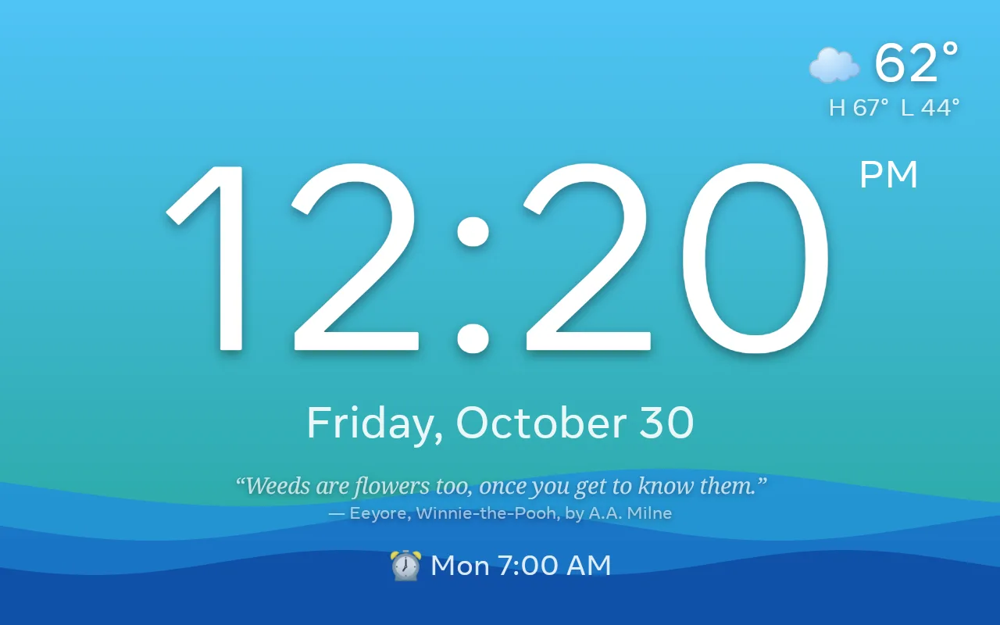
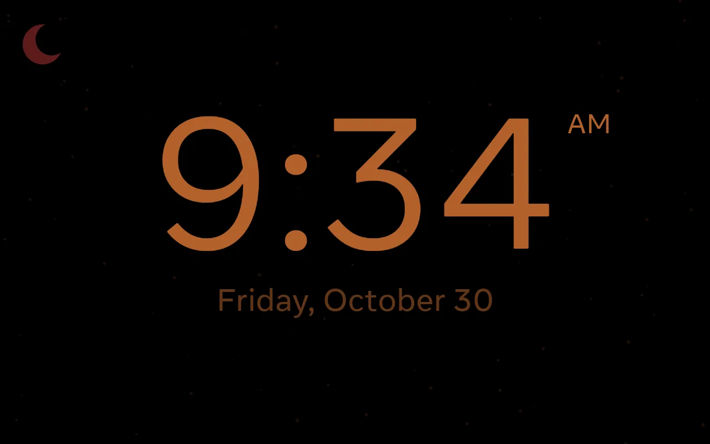
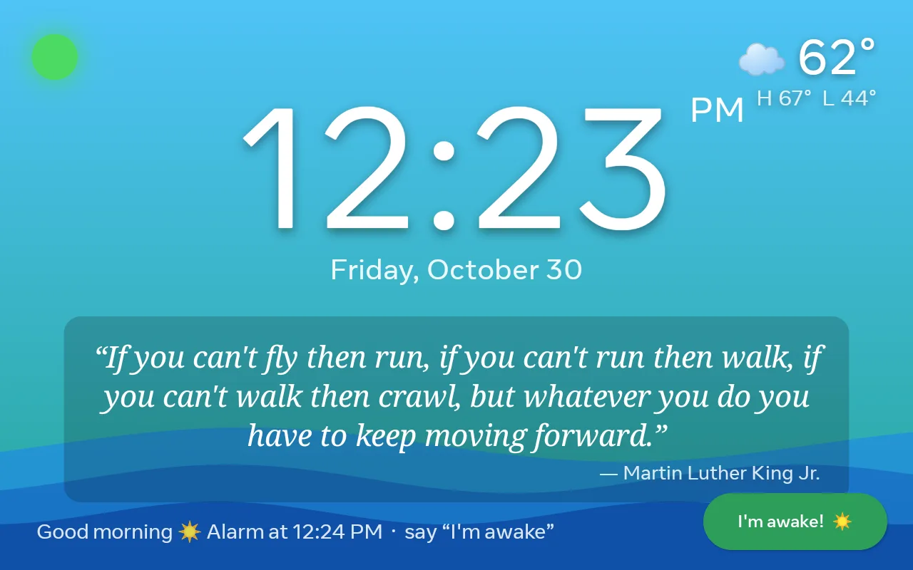
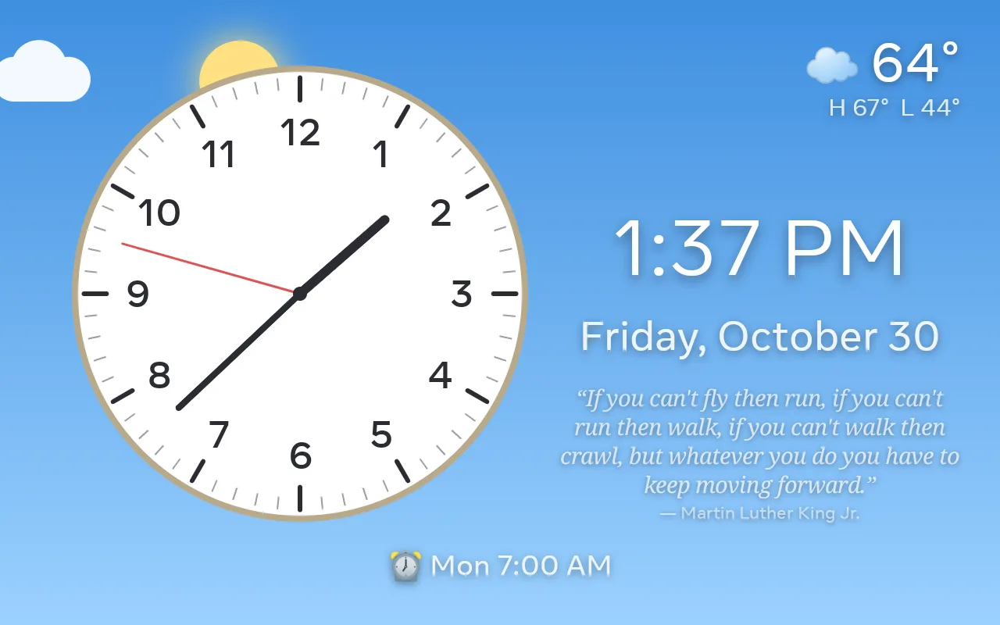
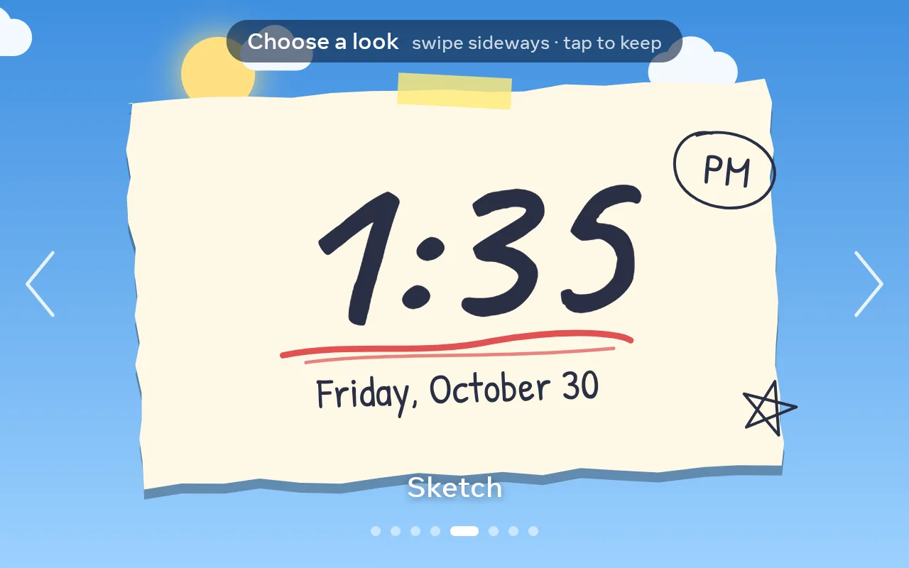
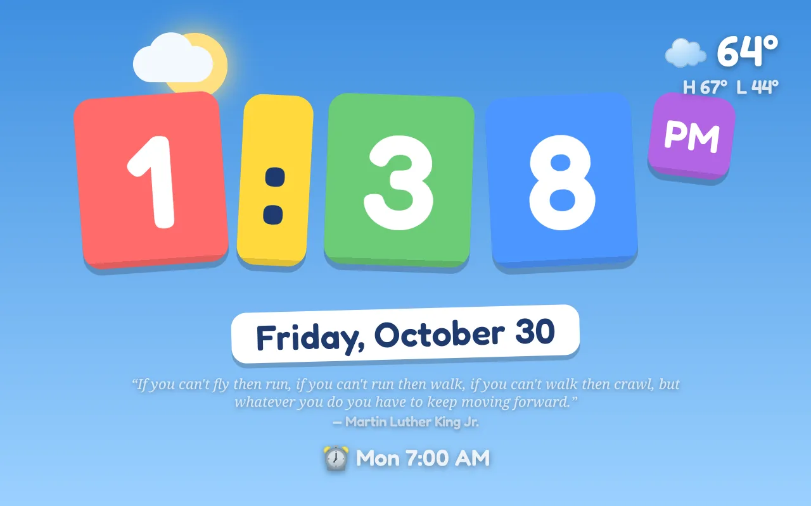

# KidClock

A fullscreen alarm clock for a converted 2018 Meta Portal (Android 9, API 28, 1280x800 landscape)
living in a kid's room. Native Kotlin, no Play Services, no camera, no accounts, nothing phones home
except an optional weather forecast.

It exists because a Portal freed by [unmetaportal](https://github.com/fcjr/unmetaportal) is a lovely
always-on screen with a good speaker and a microphone, and no alarm clock app we found treated it that way.
Fork it, or install the APK as-is: see [Install on a Portal](#install-on-a-portal) and the
[project page](https://acechase.github.io/kidclock/).

| | |
|---|---|
|  |  |
|  |  |
|  |  |

## Features
- Seven swipeable backgrounds: **Sky** (follows the real time of day: sunrise, day, sunset, stars), **Ocean**,
  **Rainbow**, **Galaxy** (nebula and shooting stars), **Fireflies** (dusk forest; a few stay lit at night), **Aurora**
  and **Meadow** (flowers and butterflies).
- Eight **looks** for the time itself, chosen separately from the background: hold the time for two seconds, then swipe
  sideways and tap to keep. **Classic**, **Bold**, **Stacked** (hour over minutes), **Analog** (a real dial with a
  sweeping second hand, for learning to read clocks), **Sketch** (hand-drawn on a paper scrap), **Whacky** (every digit
  a different font and tilt), **Pixel** (retro game) and **Magnets** (fridge tiles). Every look has an amber night version.
- Alarms via `AlarmManager.setAlarmClock`, re-registered on boot. Per-alarm days of week; one-shot alarms disable themselves.
- Ring screen with giant Snooze / Off buttons and **offline voice commands** ("snooze", "stop", "alarm off", "I'm awake")
  using Vosk. The microphone is opened only while ringing and released on snooze, dismiss, or the 10 minute timeout.
- **Night window** (default 8:30 pm to 6:30 am): black background, amber digits, screen dimmed via the window brightness
  attribute plus a dark overlay; the ambient light sensor nudges brightness. No WRITE_SETTINGS needed.
- **Always night** switch in Settings: the amber-on-black colours all day, at normal brightness (use the device's own
  brightness if it should also be dim).
- **Okay-to-wake lamp**: red crescent during the night window, green dot for 90 minutes after it ends.
- **Weather** from Open-Meteo (no API key): current temp, icon, today's high/low. Location from settings or an IP guess.
  The weather is the only thing in the app that touches the network, and it fails soft (`weather/WeatherCore.kt`,
  unit-tested with a fake network): fetches run off the main thread with 8 s timeouts, any failure is logged and
  the cache left untouched, retries back off to every 5 min, and a forecast that could not be refreshed for 3 h
  is hidden rather than shown as current (the detail screen then says "Forecast unavailable · last update ...").
  Alarms, gentle wake-up, voice and quotes never depend on connectivity.
- **Two-stage mornings**: each alarm can have a *gentle wake-up* N minutes earlier. A soft synthesized sound plays once,
  the screen goes bright with the green okay-to-wake lamp, and the **quote of the morning** appears. Saying
  "I'm awake" (or tapping the button) cancels that day's main alarm and keeps the bright display until its time.
  Otherwise the main alarm rings normally.
- **Sounds**: everything is synthesized in code (`alarm/Synth.kt`), no audio files. Settings has a chooser with a
  Play preview for each: five **alarm sounds** (Chime, Bells, Marimba, Pulse, Fanfare; `alarm/AlarmSound.kt`) that
  loop with a 30 s volume ramp and follow the sleep-inertia research (hummable melodies, dominant pitch near C5,
  112 BPM, nothing harsh or mechanical), and five **gentle wake-up sounds** (Harp, Music box, Wind chimes, Dawn chorus,
  Kalimba; `alarm/GentleSound.kt`), where chimes and birdsong are randomised so no two mornings match.
  The Portal's volume keys only move the media stream, so the app owns the separate alarm stream: while an alarm
  rings it is pinned to "Alarm volume %", during a gentle wake-up to "Gentle wake-up volume %" (default 25), and
  restored afterwards. The previews use the same levels, and adjusting either volume replays its preview.
- **Quote library**: 260 curated quotes and advice lines for a bright 11-year-old in `app/src/main/assets/quotes.json`
  (attributed quotes plus house "Morning advice"). Six are picked each day, one per theme, with no repeats for
  about a month. The current one appears large on the gentle wake-up card and, if enabled, small and quiet on the
  everyday clock face (hidden at night). Tap the quote to move to the next of the day's six. Settings
  toggle both surfaces, preview "n of 6", and can step or draw a new set.
- **Detailed weather**: double-tap the weather on the clock for the next 12 hours (temperature curve, rain chance)
  and the next six days (high/low bars). Closes on tap or after 90 s.
- **Alarm details**: tap the next-alarm line at the bottom of the clock for a read-only card about that alarm:
  time, on/off, repeat days, when it rings next (with countdown), gentle wake-up lead, snooze/“I'm awake” state.
  Closes on tap or after 60 s. Editing is in Settings (corner-hold).
- **Missed-alarm recovery**: what was registered with AlarmManager is remembered; if the device was off at that
  moment and it is less than 30 minutes late, it rings on boot instead of being dropped (`alarm/AlarmPlanner.kt`).
- **Settings** behind a deliberate gesture so stray taps never open them: hold the top-right corner for two seconds.

## Install on a Portal

You need a Portal that has been through [unmetaportal](https://github.com/fcjr/unmetaportal) (so it runs
plain Android apps and you have adb access) and a computer with `adb`. Nothing here needs root.

1. Download `kidclock-<version>.apk` from the [Releases](https://github.com/acechase/kidclock/releases) page.
2. Install it and grant the microphone (used only while an alarm is ringing, for "snooze" / "stop" / "I'm awake"):
   ```
   adb install -r -g kidclock-<version>.apk
   adb shell pm grant com.acechase.kidclock android.permission.RECORD_AUDIO
   ```
3. Make it the home screen and lock it in with unmetaportal's kiosk script (reversible with its disable script):
   ```
   ~/unmetaportal/tools/portal-kiosk-enable.sh --component com.acechase.kidclock/.ClockActivity --set-home --yes
   adb shell dumpsys deviceidle whitelist +com.acechase.kidclock   # keep the ticker and weather thread out of doze
   ```
4. Hold the top-right corner of the clock for two seconds to open Settings: add alarms, pick sounds and
   volumes, set the weather location. Swipe left or right to change the background; hold the time for two seconds,
   then swipe, to change the look.

The APK bundles the ~68 MB offline speech model, so it is about 80 MB. Builds are signed with the Android
debug key of the machine that built them; to update a Portal from a different machine, uninstall first
(settings are lost) or copy `~/.android/debug.keystore` across.

## Build and deploy
```
tools/fetch-model.sh          # one-time: downloads the ~68 MB Vosk model into app assets (not committed)
tools/deploy.sh               # build, install, grant RECORD_AUDIO, launch
tools/deploy.sh --set-home    # same, then make it HOME + kiosk via ~/unmetaportal/tools/portal-kiosk-enable.sh
```
Needs JDK 17 and an Android SDK with build-tools 36 and platform 34. `tools/env.sh` respects `JAVA_HOME` and
`ANDROID_HOME` if set, otherwise picks Homebrew `openjdk@17` and the JDK/SDK bundled with a Unity install.
`PORTAL_SERIAL` defaults to the first adb device. Release lint is disabled because the Unity SDK ships an oddly
named `android-37.0` platform folder that trips lint.

Unit tests (alarm planning, sounds, the weather failure paths): `./gradlew testDebugUnitTest`.

## Testing from adb
- Settings has "Test alarm (10 s)" and "Test gentle wake-up" (gentle sound in ~1 min, alarm 1 min later, self-deleting).
- `adb shell am broadcast -n com.acechase.kidclock/.alarm.BootReceiver -a com.acechase.kidclock.TEST_ALARM --ei seconds 20`
- A scripted double-tap: `adb shell "input tap 1130 100 & sleep 0.15; input tap 1130 100; wait"` (two plain `input tap`
  calls are too slow for the 300 ms double-tap window).

## Device notes
- Reinstalling a HOME app clears the default HOME; `tools/deploy.sh --set-home` re-applies it.
- Task lock (`am task lock`) does not survive reboot, but the HOME setting does, so the clock still comes up on boot.
- If a freshly installed app dies with "failed to attach" / "No pending application record" in logcat, the 64-bit
  zygote socket in system_server is desynchronized. A normal `adb reboot` fixes it. Never factory reset.
- Mic permission: `adb shell pm grant com.acechase.kidclock android.permission.RECORD_AUDIO` (deploy.sh does this).
- The Portal's own "Screen Lock code" was a real Android keyguard credential; it was cleared with
  `locksettings clear --old <code>` and the keyguard disabled with `locksettings set-disabled true`.
- Screensaver is disabled on the device (`settings put secure screensaver_enabled 0`) so nothing covers the clock.

## Credits and licence
- Code: MIT, see `LICENSE`.
- Offline speech: [Vosk](https://alphacephei.com/vosk/) and its small English model (Apache 2.0), downloaded by
  `tools/fetch-model.sh` and not committed.
- Weather: [Open-Meteo](https://open-meteo.com/) (CC BY 4.0), no key, called at most every 30 minutes.
- The Portal conversion, kiosk scripts and the know-how about what not to touch on the device:
  [fcjr/unmetaportal](https://github.com/fcjr/unmetaportal).
- Built with Claude Code.
