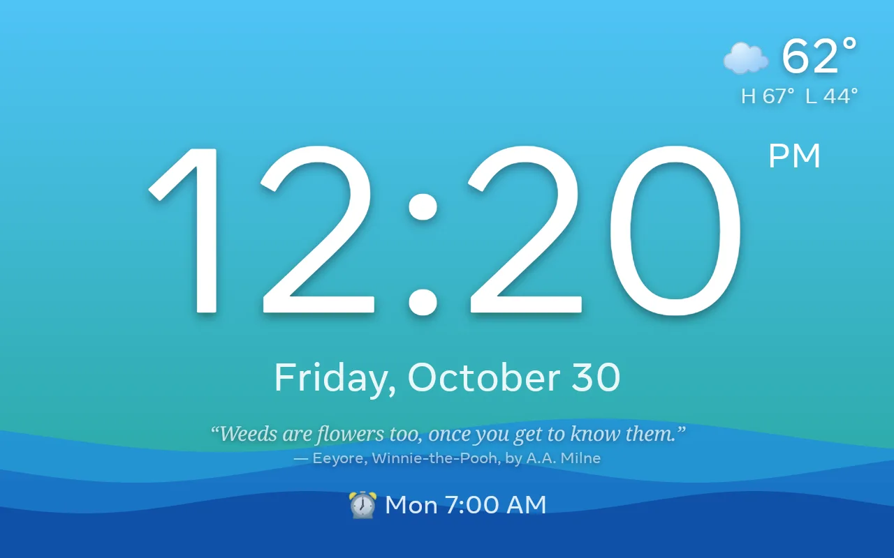
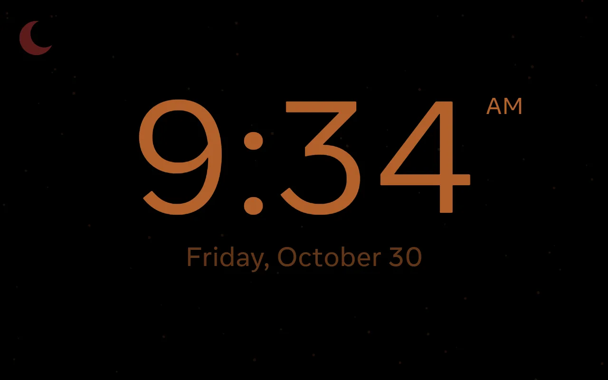
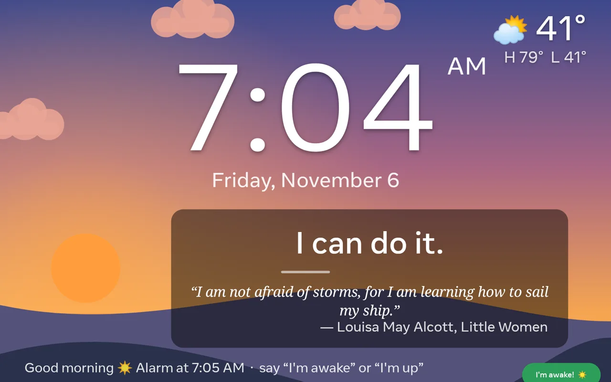
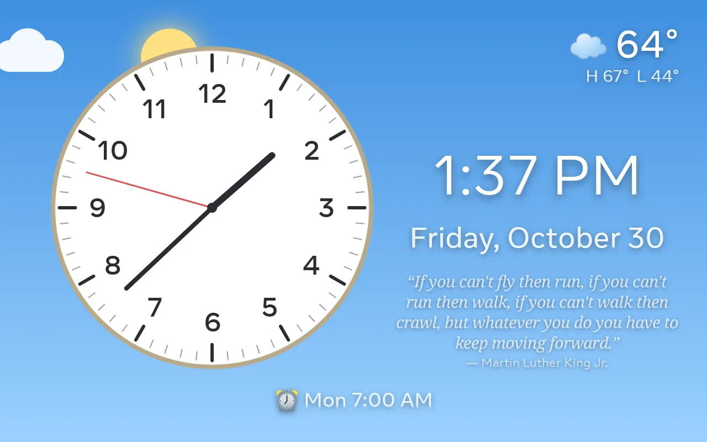
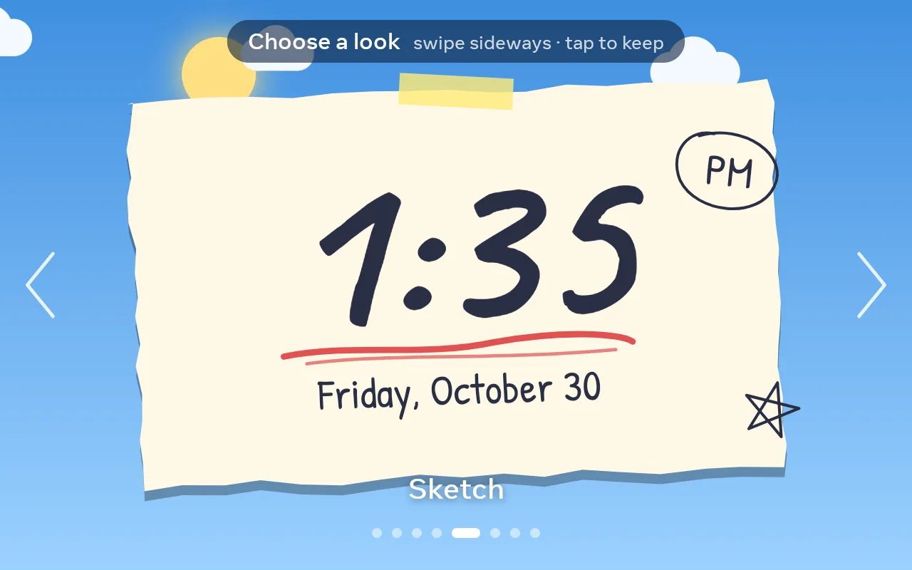
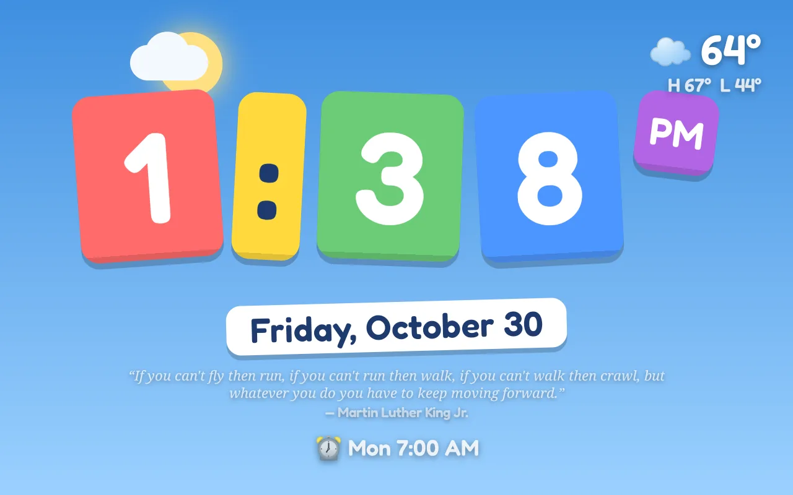
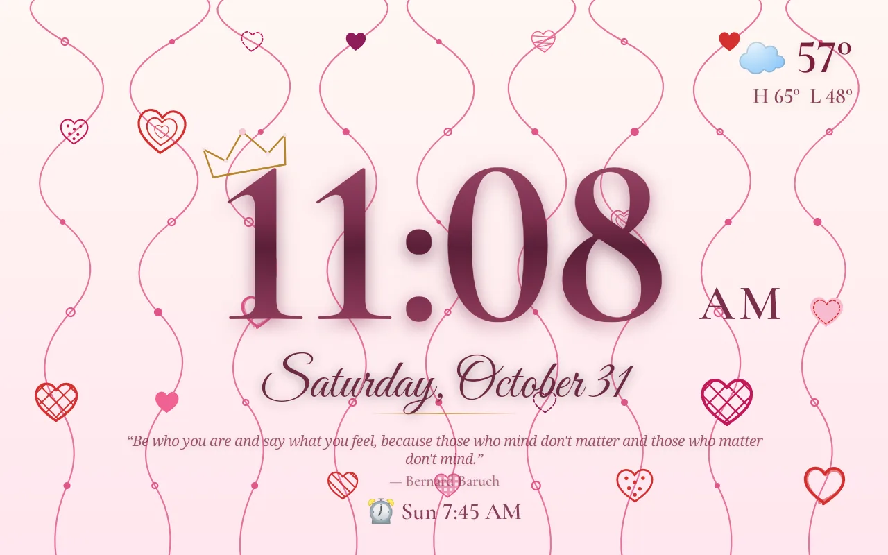
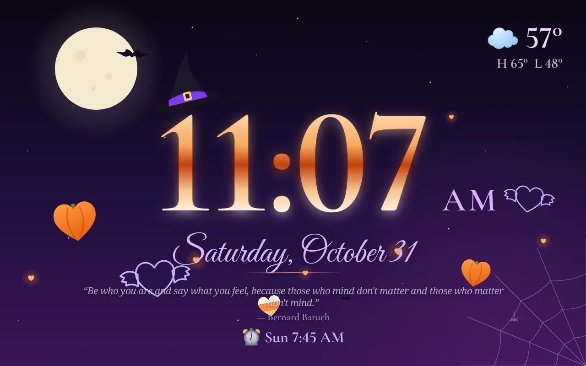
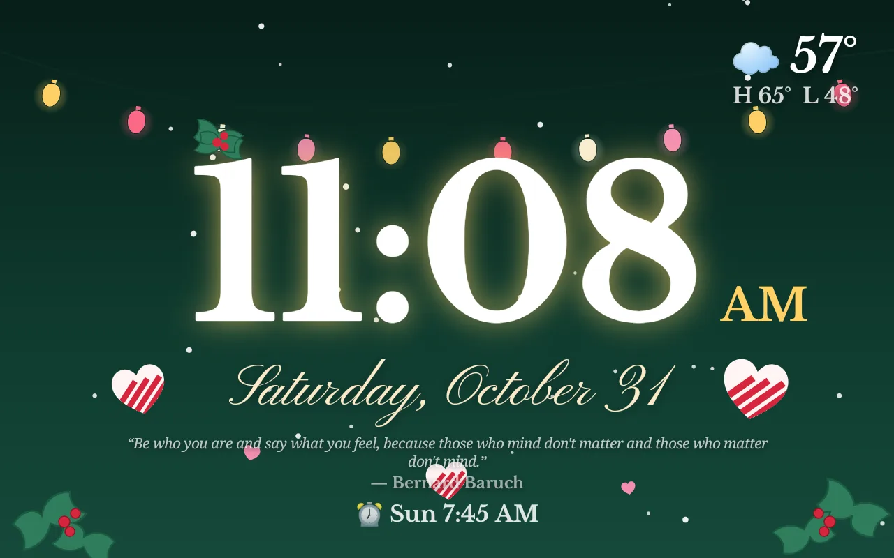

# KidClock

A fullscreen alarm clock for a converted 2018 Meta Portal (Android 9, API 28, 1280x800 landscape)
living in a kid's room. Native Kotlin, no Play Services, no camera, no accounts, nothing phones home
except an optional weather forecast.

It exists because a Portal freed by [unmetaportal](https://github.com/fcjr/unmetaportal) is a lovely
always-on screen with a good speaker and a microphone, and no alarm clock app we found treated it that way.
Fork it, or install the APK as-is: see [Install on a Portal](#install-on-a-portal) and the
[project page](https://acechase.github.io/kidclock/).

| | |
|---|---|
|  |  |
|  |  |
|  |  |
|  |  |
|  |  |

## Features
- Sixteen swipeable backgrounds, with the background's name and a row of pager dots fading in at the bottom
  while you swipe (`looks/BackgroundStrip.kt`): **Sky** (follows the real time of day: sunrise, day, sunset, stars), **Ocean**,
  **Rainbow**, **Galaxy** (nebula and shooting stars), **Fireflies** (dusk forest; a few stay lit at night), **Aurora**,
  **Meadow** (flowers and butterflies), **Doodle Strings** (beaded pink strings hung with hearts doodled in a dozen
  marker styles, swaying) and **Notebook** (a ruled page covered in doodled hearts), and seven more picked with a 6- and a 9-year-old:
  **Soccer Board** (a coach's tactics whiteboard, a pale green pitch under X-and-O plays, doodled round the edge with balls, boots, goals, whistles, cones, trophies and jerseys),
  **Stadium** (floodlight masts beaming down on a night pitch, a goal with its net in the middle), **Crab Tank** (a hermit crab tank: sand, dishes, shells, driftwood,
  a coconut hut and the crab), **Night Reef** (seaweed, rising bubbles and a crab under a moon), **Stuffies** (five
  plush animals on a star-print sheet, who swap places each day and wave now and then), **Doodle Notebook** (rockets,
  tanks, monsters, dinosaurs and robots in marker) and **Blueprint** (white line drawings on drafting blue).
- Twenty-four **looks** for the time itself. Every background but Sky was drawn for a particular look (Stuffies and
  Plush, Stadium and Scoreboard, Ocean and Tide, and so on) and brings that look along when you swipe to it; Sky shows
  the look you picked yourself. To pick one, hold anywhere on the time or date for a second, then swipe sideways and tap to keep
  (`looks/LookCatalog.kt` pairs them). **Classic**, **Bold**, **Stacked** (hour over minutes), **Analog** (a real dial with a
  sweeping second hand, for learning to read clocks), **Sketch** (hand-drawn on a paper scrap), **Whacky** (every digit
  a different font and tilt), **Pixel** (retro game), **Magnets** (fridge tiles), **Tiara** (slim serif digits in
  champagne rose with a fine tiara on the hour and a script date), **Marker** (Caveat digits with a scribbled pink
  underline) and **Marker Stacked** (the stacked layout in pink marker, with doodled tiaras), **Jersey** (navy numerals with a green
  shadow over a scoreboard date strip), **Scoreboard** (LED digits in a black panel), **Beach** (rounded navy digits
  with a water-blue shadow), **Bubble** (each digit in its own bubble), **Plush** (cream digits with a brown outline
  and a pink shadow), **Marker Blue** (blue marker digits with a green scribble), **Stencil** (Black Ops One), and
  six for the skies: **Tide** (white digits half under a rolling waterline), **Rainbow Arch** (a seven-band rainbow arching
  up behind fat white digits), **Nebula** (Orbitron digits in a glowing pink-to-cyan nebula with twinkling stars),
  **Glow** (firefly yellow-green digits in a soft glow, with fireflies drifting round them), **Borealis** (tall digits
  filled with rippling aurora colours) and **Daisy** (leaf-green digits with daisies for the colon).
  Every look has an amber night version.
- **Holiday designs**: a special background *and* look for New Year's Eve, Valentine's Day, St. Patrick's Day, Easter,
  the Fourth of July, Halloween, Thanksgiving and Christmas. Each appears on its own three days before the holiday
  and goes away the day after, giving the chosen background and look back. Swiping to another background or picking
  another look while a holiday design is showing counts as a decision: that choice stays and there is no switch-back
  until next year. A switch in Settings turns the feature off. Easter and Thanksgiving are computed
  (`holiday/Holiday.kt`); the on/off logic is pure and unit-tested (`holiday/HolidayPlanner.kt`).
- Alarms via `AlarmManager.setAlarmClock`, re-registered on boot. Per-alarm days of week; one-shot alarms disable themselves.
- Ring screen dressed for the day's weather (the same painted skies as the weather page), with a big moon for Snooze
  and a big sun for "I'm up!" and the words underneath, plus **offline voice commands** ("snooze", "stop", "off",
  "alarm off", "I'm up", "I'm awake")
  using Vosk. The microphone is opened only while ringing and released on snooze, dismiss, or the 10 minute timeout.
  A whole phrase has to be heard clearly, except the "I'm up" / "I'm awake" family: a quick "I'm up!" reaches the
  recogniser as "am up" or "i'm up" with the short "up" at low confidence, so those are matched word by word at a
  lower bar (a lone "up" still does nothing). The rules are pure and unit-tested in `voice/VoiceMatcher.kt`.
- **Night window** (default 8:30 pm to 6:30 am): black background, amber digits, screen dimmed via the window brightness
  attribute plus a dark overlay; the ambient light sensor nudges brightness. No WRITE_SETTINGS needed.
- **Always night** switch in Settings: the amber-on-black colours all day, at normal brightness (use the device's own
  brightness if it should also be dim).
- **Stay-in-bed moon**: a red crescent in the top-left corner during the night window. There is no morning lamp;
  the gentle wake-up sunrise is the signal that it is time to get up.
- **Weather** from Open-Meteo (no API key): current temp, icon, today's high/low. Location from settings or an IP guess.
  The weather is the only thing in the app that touches the network, and it fails soft (`weather/WeatherCore.kt`,
  unit-tested with a fake network): fetches run off the main thread with 8 s timeouts, any failure is logged and
  the cache left untouched, retries back off to every 5 min, and a forecast that could not be refreshed for 3 h
  is hidden rather than shown as current (the detail screen then says "Forecast unavailable · last update ...").
  Alarms, gentle wake-up, voice and quotes never depend on connectivity.
- **Two-stage mornings**: each alarm can have a *gentle wake-up* N minutes earlier. A soft synthesized sound plays once,
  and the chosen background gives way to a **sunrise** that takes the whole N minutes: deep night with stars, first
  light on the horizon, the sun coming up over the hills, birds, full morning at the alarm's time. The screen
  brightness comes up with it (from dim to full), so the room lightens the way a real morning does, and the
  **quote of the morning** sits beside the sun. Saying "I'm awake" or "I'm up" (or tapping the button) cancels that day's main
  alarm, finishes the sunrise and keeps the bright display until its time. Otherwise the main alarm rings normally.
  (`night/Sunrise.kt` is the arithmetic and the colour keyframes, unit-tested; `faces/SunriseScene.kt` paints it.)
- **Sounds**: everything is synthesized in code (`alarm/Synth.kt`), no audio files. Settings has a chooser with a
  Play preview for each: five **alarm sounds** (Chime, Bells, Marimba, Pulse, Fanfare; `alarm/AlarmSound.kt`) that
  loop with a 30 s volume ramp and follow the sleep-inertia research (hummable melodies, dominant pitch near C5,
  112 BPM, nothing harsh or mechanical), and five **gentle wake-up sounds** (Harp, Music box, Wind chimes, Dawn chorus,
  Kalimba; `alarm/GentleSound.kt`), where chimes and birdsong are randomised so no two mornings match.
  The Portal's volume keys only move the media stream, so the app owns the separate alarm stream: while an alarm
  rings it is pinned to "Alarm volume %", during a gentle wake-up to "Gentle wake-up volume %" (default 25), and
  restored afterwards. The previews use the same levels, and adjusting either volume replays its preview.
- **Who is this clock for**: Settings starts with the ages of the youngest and oldest kid using the clock. Every
  quote carries a minimum age, so the daily pool is the quotes written for the oldest kid's age or younger. An
  **Early reader** switch (on by itself while the youngest is under 7) turns on three picture-first screens, each with
  its own override: a few easy sight words on top of the morning quote with the full quote beneath, what-to-wear and
  raincoat picture tiles on the weather page, and picture buttons when the alarm rings. The rules are pure and
  unit-tested (`quotes/QuoteRules.kt`).
- **Quote library**: nearly 300 curated quotes and advice lines for a bright 11-year-old in `app/src/main/assets/quotes.json`
  (attributed quotes plus house "Morning advice"). Six are picked each day, one per theme, with no repeats for
  about a month. The current one appears large on the gentle wake-up card and, if enabled, small and quiet on the
  everyday clock face (hidden at night). Tap the quote to move to the next of the day's six. Settings
  toggle both surfaces, preview "n of 6", and can step or draw a new set.
- **Weather page**: tap the weather on the clock for a page written for a kid: the temperature now and where the
  day is going ("It warms up to 67° this afternoon, which is nice."), whether to pack a raincoat, what to wear
  ("Wear a hoodie or a light jacket. You can take it off later."), the temperature when leaving for school, at
  lunch, after school and at bedtime, and the week in a sentence ("Rain tomorrow, then it gets warmer every day.
  Wednesday is the warmest."). The wording is rule-based (`weather/WeatherWords.kt`, unit-tested) and follows the
  forecast's unit. The page is dressed for the sky right now, painted in code like the clock backgrounds: sunny,
  cloudy, rainy, snowy, thunderstorm, or a clear night (`weather/WeatherSky.kt`, `weather/SkyView.kt`). Closes on
  tap or after 90 s.
- **Alarm details**: tap the next-alarm line at the bottom of the clock for a read-only card about that alarm:
  time, on/off, repeat days, when it rings next (with countdown), gentle wake-up lead, snooze/“I'm awake” state.
  Closes on tap or after 60 s. Editing is in Settings (corner-hold).
- **Missed-alarm recovery**: what was registered with AlarmManager is remembered; if the device was off at that
  moment and it is less than 30 minutes late, it rings on boot instead of being dropped (`alarm/AlarmPlanner.kt`).
- **Settings** behind a deliberate gesture so stray taps never open them: hold the top-left corner for a second.

## Install on a Portal

You need a Portal that has been through [unmetaportal](https://github.com/fcjr/unmetaportal) (so it runs
plain Android apps and you have adb access) and a computer with `adb`. Nothing here needs root.

1. Download `kidclock-<version>.apk` from the [Releases](https://github.com/acechase/kidclock/releases) page.
2. Install it and grant the microphone (used only while an alarm is ringing, for "snooze" / "stop" / "I'm awake"):
   ```
   adb install -r -g kidclock-<version>.apk
   adb shell pm grant com.acechase.kidclock android.permission.RECORD_AUDIO
   ```
3. Make it the home screen and lock it in with unmetaportal's kiosk script (reversible with its disable script):
   ```
   ~/unmetaportal/tools/portal-kiosk-enable.sh --component com.acechase.kidclock/.ClockActivity --set-home --yes
   adb shell dumpsys deviceidle whitelist +com.acechase.kidclock   # keep the ticker and weather thread out of doze
   ```
4. Hold the top-left corner of the clock for a second to open Settings: add alarms, pick sounds and
   volumes, set the weather location. Swipe left or right to change the background (its matching look comes with
   it); hold the time or date for a second, then swipe, to pick a different look.

The APK bundles the ~68 MB offline speech model, so it is about 80 MB. Builds are signed with the Android
debug key of the machine that built them; to update a Portal from a different machine, uninstall first
(settings are lost) or copy `~/.android/debug.keystore` across.

## Build and deploy
```
tools/fetch-model.sh          # one-time: downloads the ~68 MB Vosk model into app assets (not committed)
tools/deploy.sh               # build, install, grant RECORD_AUDIO, launch
tools/deploy.sh --set-home    # same, then make it HOME + kiosk via ~/unmetaportal/tools/portal-kiosk-enable.sh
```
Needs JDK 17 and an Android SDK with build-tools 36 and platform 34. `tools/env.sh` respects `JAVA_HOME` and
`ANDROID_HOME` if set, otherwise picks Homebrew `openjdk@17` and the JDK/SDK bundled with a Unity install.
`PORTAL_SERIAL` defaults to the first adb device. Release lint is disabled because the Unity SDK ships an oddly
named `android-37.0` platform folder that trips lint.

Unit tests (alarm planning, sounds, the weather failure paths, holiday dates and switching): `./gradlew testDebugUnitTest`.
Fonts are not committed as a build step; `tools/fetch-fonts.sh` re-downloads the bundled ones (see `FONTS.md`).

## Testing from adb
- Settings → Advanced has "Test alarm (10 s)" and "Test gentle wake-up" (gentle sound in ~1 min, alarm 1 min later, self-deleting).
  `tools/test-alarm.sh --gentle 5` does the same with a five-minute sunrise.
- `adb shell am broadcast -n com.acechase.kidclock/.alarm.BootReceiver -a com.acechase.kidclock.TEST_ALARM --ei seconds 20`
- `tools/test-night.sh on|off` shows the amber night colours all day; `tools/test-holiday.sh halloween` (or `newyear`,
  `valentine`, `stpatrick`, `easter`, `july4`, `thanksgiving`, `christmas`, `off`) shows a holiday design now.
- `adb shell input tap 1130 100` opens the weather page; `adb shell input swipe 60 60 60 60 1200` holds the
  top-left corner and opens Settings; `adb shell input swipe 640 400 640 400 1200` opens the look picker. `tools/test-weather.sh RAINY` opens the weather page dressed for a sky
  (`SUNNY CLOUDY RAINY SNOWY STORMY NIGHT`).

## Device notes
- Reinstalling a HOME app clears the default HOME; `tools/deploy.sh --set-home` re-applies it.
- Task lock (`am task lock`) does not survive reboot, but the HOME setting does, so the clock still comes up on boot.
- If a freshly installed app dies with "failed to attach" / "No pending application record" in logcat, the 64-bit
  zygote socket in system_server is desynchronized. A normal `adb reboot` fixes it. Never factory reset.
- Mic permission: `adb shell pm grant com.acechase.kidclock android.permission.RECORD_AUDIO` (deploy.sh does this).
- The Portal's own "Screen Lock code" was a real Android keyguard credential; it was cleared with
  `locksettings clear --old <code>` and the keyguard disabled with `locksettings set-disabled true`.
- Screensaver is disabled on the device (`settings put secure screensaver_enabled 0`) so nothing covers the clock.

## Credits and licence
- Code: MIT, see `LICENSE`.
- Offline speech: [Vosk](https://alphacephei.com/vosk/) and its small English model (Apache 2.0), downloaded by
  `tools/fetch-model.sh` and not committed.
- Weather: [Open-Meteo](https://open-meteo.com/) (CC BY 4.0), no key, called at most every 30 minutes.
- The Portal conversion, kiosk scripts and the know-how about what not to touch on the device:
  [fcjr/unmetaportal](https://github.com/fcjr/unmetaportal).
- Built with Claude Code.
